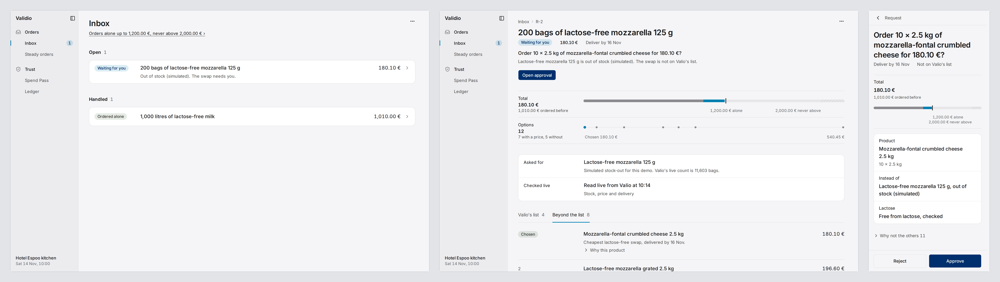

# Attention Is All We Have

*Your agent places the order. Validio checks it before any money moves.*

Validio is our entry for Valio Aimo's challenge "Trusted Trade Agents" at Junction 2026. It sits between a kitchen's purchasing agent and Valio's wholesale API. For every fact it uses (stock, price, allergen, claim) it knows how far that fact can be trusted. Rules the AI model cannot override decide whether the agent may order alone, has to ask a person or is blocked. Every step lands in one hash-chained log that the kitchen and Valio read the same way.

The inbox, the request that waits for the owner, and its approval on a phone, captured from the demo build.

- Live demo: (link follows)
- Video: (link follows)
- Pitch deck: (link follows)

**In progress today:** one account per kitchen with its own settings and agent connect, see [validio/docs/PLAN-ACCOUNTS.md](validio/docs/PLAN-ACCOUNTS.md).

Start in [validio/README.md](validio/README.md). It explains the setup, the architecture and a quick look that needs no key and no data. The plan with the reasoning behind each part is [PROJECT_BLUEPRINT-validio.md](PROJECT_BLUEPRINT-validio.md).

Our second project, Zombie Facts for MariaDB's challenge "Wikipedia Through Time", lives in [zombie-facts/](zombie-facts/README.md). Its plan is [PROJECT_BLUEPRINT-zombie-facts.md](PROJECT_BLUEPRINT-zombie-facts.md).
