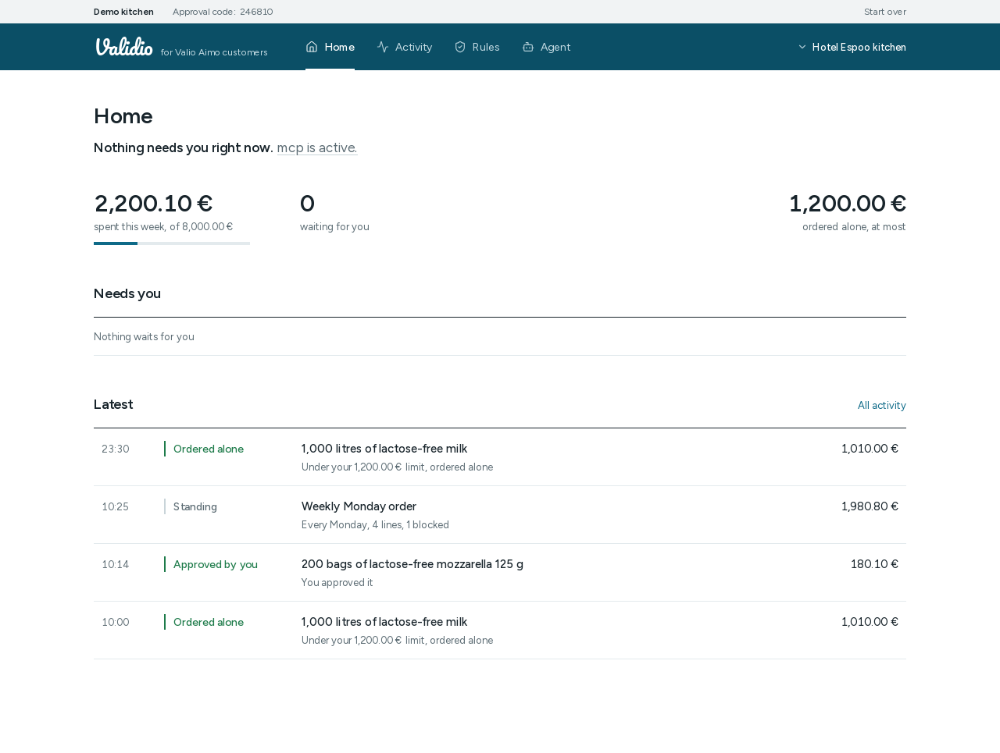
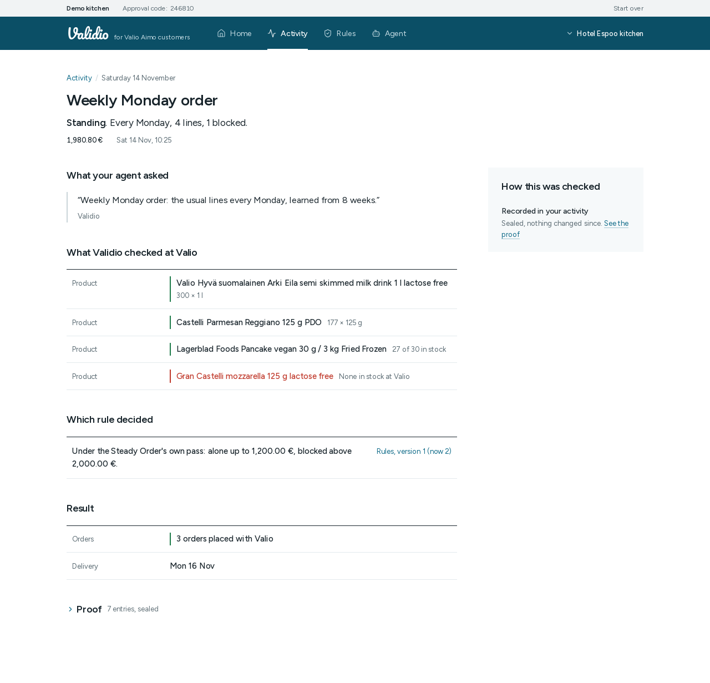
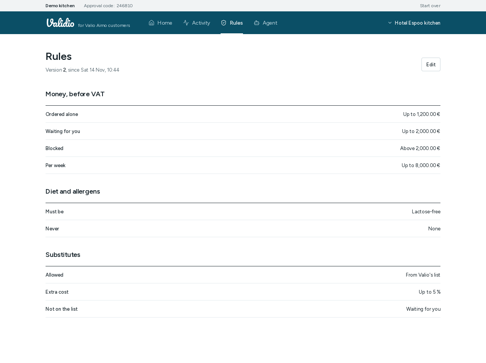
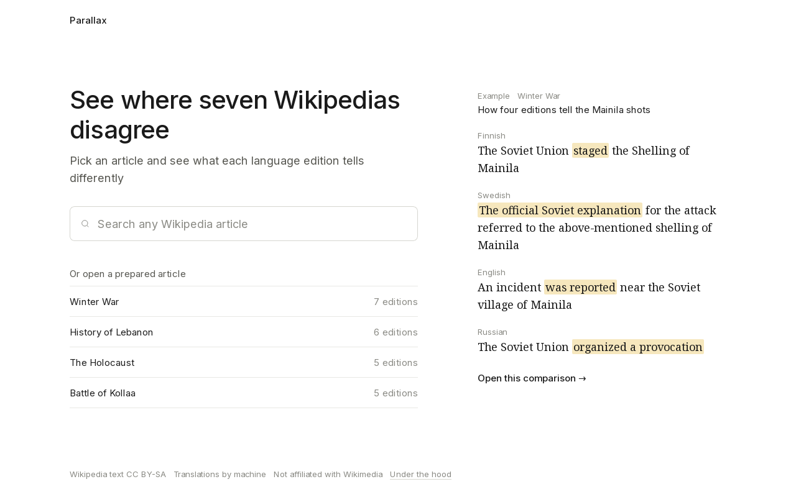
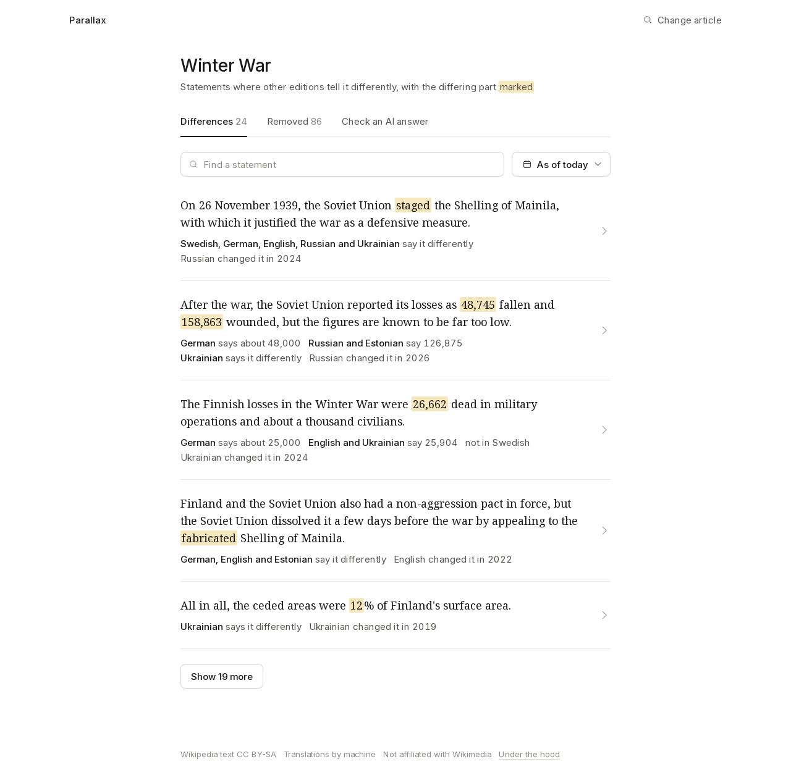
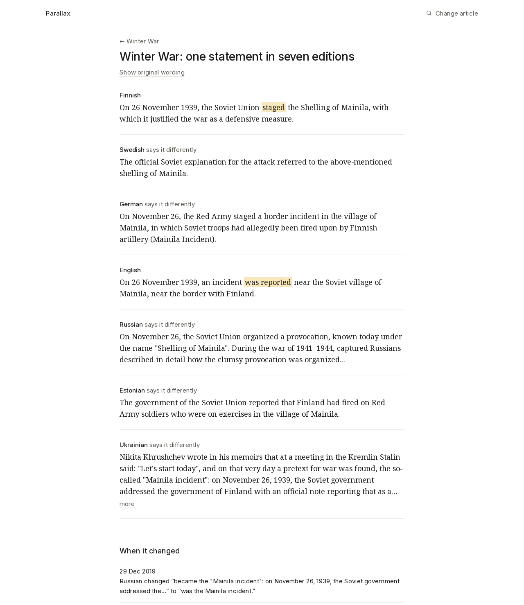
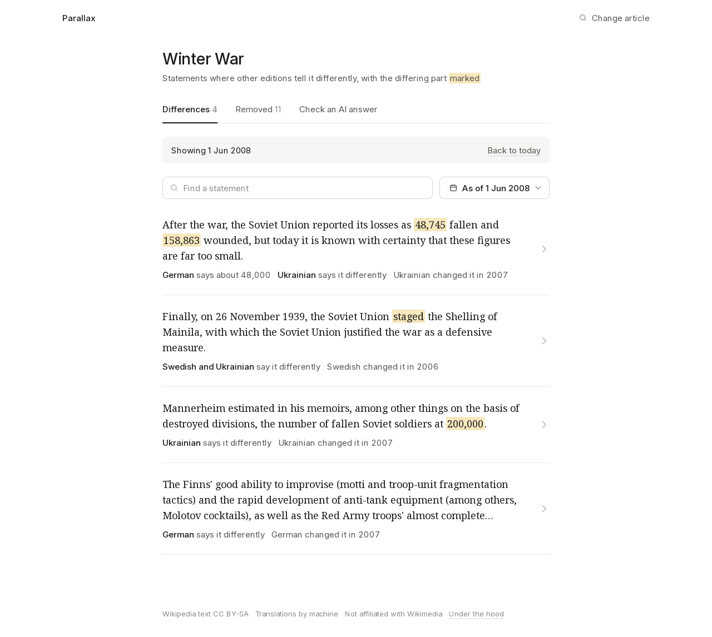
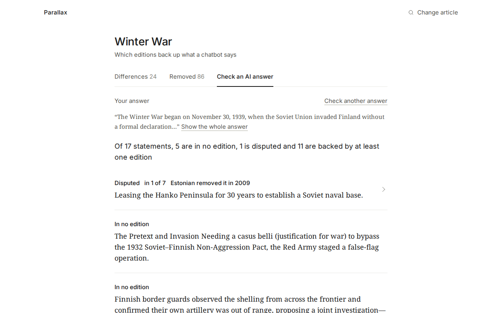

# Attention Is All We Have

This repository holds the two projects our team built at Junction 2026 in Espoo (13 to 15 November 2026). The two share only this repo and each one has its own folder, README and CI workflow.

| Project | Challenge | What it does | Live | Folder |
|:---|:---|:---|:---|:---|
| Validio | Valio Aimo, "Trusted Trade Agents" | A kitchen's purchasing agent orders from Valio Aimo within rules the kitchen sets | [timkicker--validio.us-east.modal.run](https://timkicker--validio.us-east.modal.run) | [validio/](validio/README.md) |
| Parallax | MariaDB, "Wikipedia Through Time" | See where seven Wikipedias disagree and since when | [135.181.63.238.sslip.io](https://135.181.63.238.sslip.io), [video](https://youtu.be/eeRs_a-xHF0) | [parallax/](parallax/README.md) |

## Validio



A kitchen connects its purchasing agent to Validio and the agent orders from Valio Aimo through it. Within the kitchen's Rules the agent orders automatically. Above them the order waits until the owner approves it with a code. Beyond them it is blocked. Four Cedar rules make that decision from Valio's own product data and the kitchen's signed Spend Pass, so neither model output nor supplier text can change it. Every decision, approval and Rules change goes into a hash-chained ledger with a signed head.

### Try it in a minute

1. Open https://timkicker--validio.us-east.modal.run and click **Try the demo kitchen**. Your browser gets its own copy of a demo kitchen that already has a few orders in it. **Start over** in the bar on top resets that copy.
2. Look at **Home**, then open an item in **Activity**. Each item shows what the agent asked for, what Validio checked at Valio, the rule that decided and the result (Ordered alone, Waiting for you or Blocked).
3. **Rules** shows the limits. Change one with **Edit** and the approval code 246810.
4. To connect your own agent, go to **Agent** and click **Connect agent**. Any MCP client works (for example `claude mcp add --transport http validio <URL>`). Then ask it for "1000 litres of lactose-free milk by Monday, budget 1200 euro". The steps are in [validio/README.md](validio/README.md#quick-start-with-any-mcp-client).

| Activity, one item | Rules |
|:---:|:---:|
|  |  |

### What is real and what is simulated

The 17,546 products come from Valio's challenge files. Prices and availability are real answers from Valio's test API, recorded once for delivery days 16 to 20 November 2026 and replayed by the app, which never calls Valio while it runs. Valio's test API has no order endpoint, so nothing is really ordered: "placed" means placed in Validio. We simulated a stock-out of one mozzarella, the order history behind the weekly Steady Order and one planted line in a product description that talks to AI agents. The app marks the stock-out and the history as simulated. Valio's data and the recordings are not in this repo, because Valio allows their use for the challenge only.

### Built with

Python 3.12 with FastAPI, Cedar, SD-JWT and ES256 keys, MCP and OpenAPI 3.1, SvelteKit, SQLite. Hosted on Modal.

Everything else (rules, architecture, tests, deploy, limits) is in [validio/README.md](validio/README.md). The plan we wrote before building is [PROJECT_BLUEPRINT-validio.md](PROJECT_BLUEPRINT-validio.md).

## Parallax



**See where seven Wikipedias disagree, and since when.**

Parallax lines up seven language editions of Wikipedia (Finnish, Swedish, German, English, Russian, Estonian and Ukrainian) statement by statement. It shows where an edition tells the same thing differently, which statements one edition removed while others kept them and how all of that looked on any past day. It also checks a chatbot answer against the editions. Every revision is stored in MariaDB 12.3 system-versioned tables and one query combines `FOR SYSTEM_TIME AS OF` with vector search to match statements across languages at a given date. Parallax reads Wikipedia and never edits it.

### Try it in a minute

1. Open the Winter War, which is preloaded: https://135.181.63.238.sslip.io/t/Q134949. Each row is a Finnish statement that other editions tell differently, with the differing part marked.
2. Click the first row (the shelling of Mainila) to see that statement in all seven editions and when each one changed.
3. Go back in time: https://135.181.63.238.sslip.io/t/Q134949?date=2008-06-01 shows the same comparison as of 1 June 2008.
4. Open **Check an AI answer**, paste what a chatbot told you about the Winter War and click **Check answer**. After about 20 seconds it shows for each statement which editions back it or removed it. Statements that are in no edition are marked too. The recorded Gemini answers below the text box work too.

The demo video is at https://youtu.be/eeRs_a-xHF0.

| The Winter War, differences today | One statement in seven editions | The same article on 1 June 2008 |
|:---:|:---:|:---:|
|  |  |  |



### How it works

Differences, removed statements, past days and the history of each statement are computed from the stored Wikipedia revisions. Each sentence gets a bge-m3 vector, vector search finds the closest sentences in the other editions on the chosen day and Gemini 3.8 Flash decides for each pair whether it is the same statement, marks the numbers and terms that differ and translates it into English. A pasted chatbot answer is split into statements and checked the same way; if Gemini is slow, vector similarity decides and the statement says so. Any article with a Finnish version can be loaded from the start page and its comparison opens after one to two minutes.

| | |
|:---|:---|
| Revisions stored | 875,572 |
| Sentence vectors | 90,070 |
| Finnish sentence lives (all revisions of 19,742 articles) | 1,118,463 |
| `AS OF` over 1.1 million rows, median | 0.86 ms |
| `AS OF` together with vector search in one article, median | 5 ms |
| Embedding on a Verda A100 | 4,555 sentences/s |

### Built with

MariaDB 12.3 (system-versioned tables, `VECTOR` columns with an HNSW index and `VEC_DISTANCE_COSINE`), bge-m3 embeddings (Ollama, sentence-transformers on a Verda A100), Gemini 3.8 Flash for matching, translation and answer checks, Python with FastAPI, a Svelte web app built with Vite and Wikimedia Codex tokens. Hosted on a Verda server with Docker Compose and Caddy.

Everything else (how it works in detail, pages, API, seeds, tests) is in [parallax/README.md](parallax/README.md), deployment in [parallax/deploy/README.md](parallax/deploy/README.md) and the product notes in [parallax/docs/PRODUCT.md](parallax/docs/PRODUCT.md).

## Repository layout

| Path | What is in it |
|:---|:---|
| `validio/` | Validio: backend, web app, Modal app, scripts and docs |
| `parallax/` | Parallax: pipeline, API, web app, database schema, deploy files and docs |
| `docs/img/` | the screenshots and diagrams used in the READMEs |
| `PROJECT_BLUEPRINT-validio.md` | Validio's plan and the reasoning behind each part |
| `WORKING.md` | how the team split the work during the event |
| `.github/workflows/` | one CI workflow per project |

## Run them locally

Validio needs Python 3.12 with uv, Node 20 or newer, a Valio API key and Valio's three challenge files. Without the key and files you can still run the web app on its fixture (`make demo-mock`). From `validio/`:

```sh
make setup RAW=/path/to/valio/files
make record      # asks Valio's test API once and stores the answers
make demo        # http://127.0.0.1:8410
```

Parallax needs Docker, uv, Node 20 and Ollama with `bge-m3`. From `parallax/`:

```sh
cp .env.example .env
make db-up && make seed && make app-stats
make demo        # http://127.0.0.1:8000
```

The full steps, tests and deploy targets are in [validio/README.md](validio/README.md#run-it-locally) and [parallax/README.md](parallax/README.md#run-it-locally).

## Team

Tim Kicker, Pavlo Vus, Abdallah Srayeldine and Krish Chopra, as "Attention Is All We Have" at Junction 2026.

## Licence

MIT, see [LICENSE](LICENSE). Wikipedia text shown by Parallax is CC BY-SA. Valio's product data is not part of this repository.
