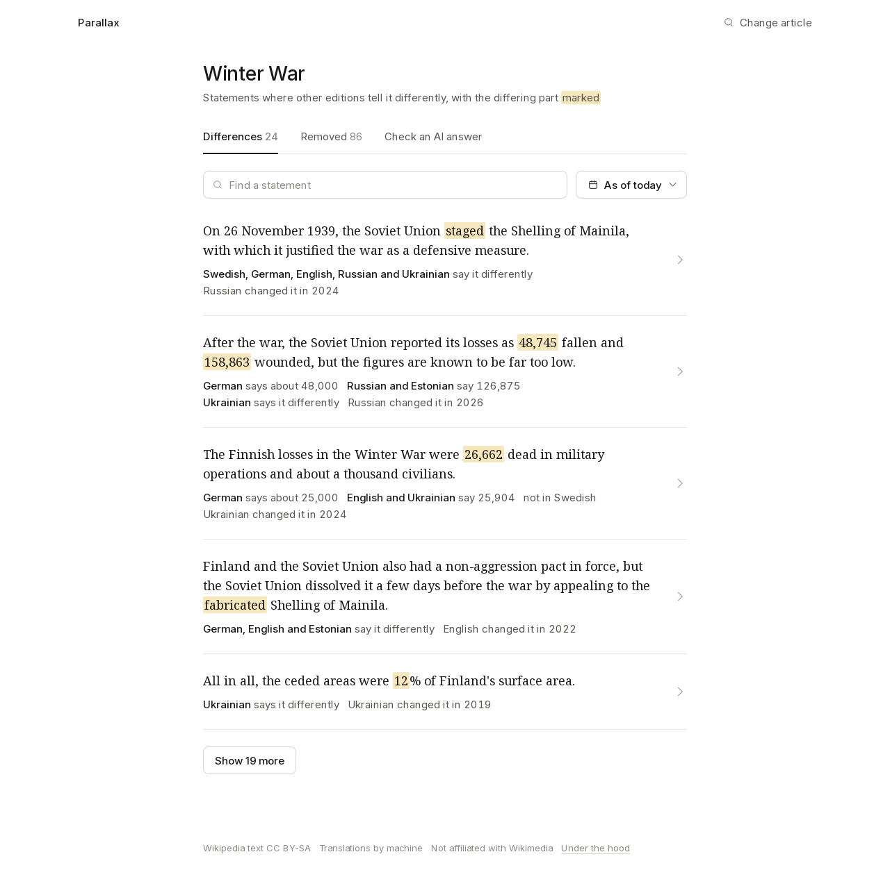
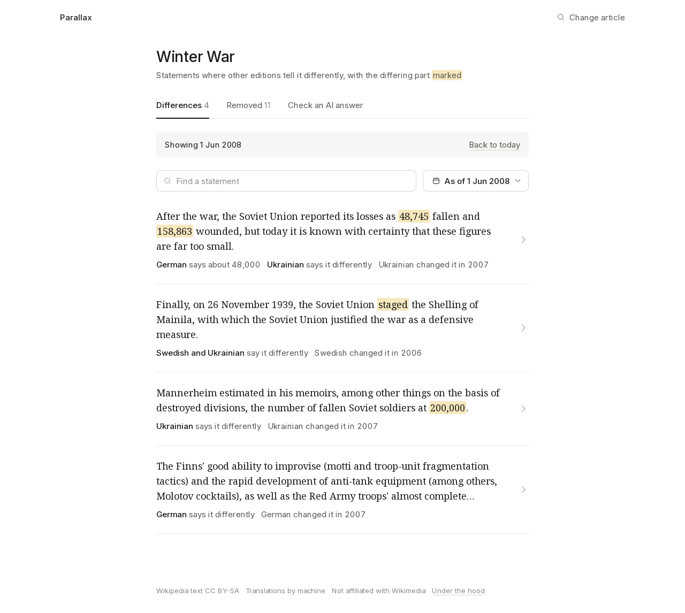
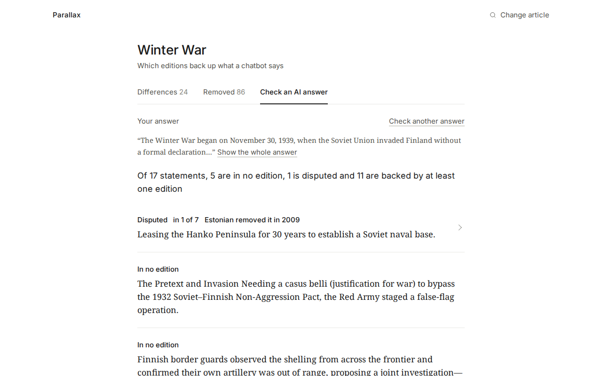
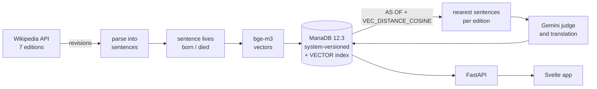

# Parallax

**See where seven Wikipedias disagree, and since when.**

Parallax lines up the Finnish, Swedish, German, English, Russian, Estonian and Ukrainian editions of a Wikipedia article sentence by sentence. It shows where an edition tells the same thing differently, which statements one edition removed while the others kept them, how all of that looked on any day in the past, and which editions back what a chatbot told you.

Every revision lives in MariaDB 12.3 system-versioned tables next to a multilingual vector for each sentence, so a single SQL statement can travel back to any date **and** match sentences across languages: `FOR SYSTEM_TIME AS OF` together with `VEC_DISTANCE_COSINE`.

**Live:** https://135.181.63.238.sslip.io · **Video:** https://youtu.be/eeRs_a-xHF0 · Built at Junction 2026 for MariaDB's challenge "Wikipedia Through Time".



## Why

Most people read Wikipedia in one language and never notice that the same article says something else in another one. Editors rarely notice either, because they work on one edition at a time. The Winter War is a good example. The Finnish edition says the Soviet Union staged the shelling of Mainila. The German one says the same thing in other words. The English one has said only that "an incident was reported" since August 2009. The Russian one dropped "staged by the Soviet side" in July 2014. Each of these is visible only when you put the editions side by side and look at them over time. Parallax does both.

## Try it in a minute

1. Open the Winter War, which is preloaded: https://135.181.63.238.sslip.io/t/Q134949. Each row is a Finnish statement that other editions tell differently, with the differing words marked.
2. Click the first row, the shelling of Mainila. You see it in all seven editions and the year each of them changed it.
3. Go back in time: https://135.181.63.238.sslip.io/t/Q134949?date=2008-06-01 shows the comparison as it stood on 1 June 2008.
4. Open **Check an AI answer**, paste what a chatbot told you about the Winter War and click **Check answer**. Every statement of the answer is checked against all seven editions. You can also pick one of the recorded Gemini answers below the text box.
5. Type any other article on the start page. Its comparison opens after one to two minutes.

## What you can do

### Differences

The first page of an article lists the statements that other editions tell differently, with the differing part marked: a number, a date, a term or a verb. Each line is shown in its original language and in English. Click a statement to see it in every edition, with a timeline of when each edition added, reworded or removed it and a link to the exact revision on Wikipedia.


### Any past day

Pick a date and every edition is cut at the same instant. The whole comparison is rebuilt from what each edition said on that day. On 1 June 2008 the Winter War had 4 differences. On 14 November 2026 it had 24.



### Removed

This page lists statements that one edition removed while other editions still have them. Each comes with the date of the removal, the edit comment and the last revision that still had it, so you can read it in context.

### Check an AI answer

Paste what a chatbot said. Gemini splits the answer into statements (up to 20), vector search finds the closest sentences in every edition over its whole history, and Gemini decides for each pair whether it is the same statement. Each statement then reads **Backed by** (with the editions), **Disputed** (some editions removed it, with the year) or **In no edition**.

We asked Gemini how the Winter War started and pasted its whole answer. Parallax split it into 17 statements. It found 11 in at least one edition and 5 in none. It marked the lease of the Hanko peninsula as disputed, because the Estonian edition removed it in 2009.

A check always finishes. Every check gets its own Gemini time budget. If Gemini is slow or out of quota, that part is decided by vector similarity instead and the statement says which of the two decided it.




### Any article

Search any Wikipedia article that has a Finnish version and pick it. A progress page shows each edition as it loads. The comparison opens as soon as the Finnish page and one other edition are in, usually within one to two minutes. The remaining editions keep loading in the background.

### Under the hood

The page shows the vector query behind the Differences list, run live, together with its time, the rows it read and the index it used, and the numbers behind the data. Every JSON response of the API carries the SQL statements that produced it.

## How it works



1. **Fetch.** The pipeline fetches the revision history of the article in all seven editions. It sends a descriptive User-Agent, makes at most three requests at once, honours `Retry-After` and `maxlag` and caches every response on disk, so nothing is fetched twice.
2. **Sentence lives.** Each revision's wikitext is parsed into sentences. A sentence that appears in revision A and disappears in revision B becomes one row whose system-time period is exactly the time the edition stated it. Edits undone within 24 hours or by a revert, such as vandalism or page blanking, are filtered out, so a sentence's life is not cut by a brief disruption.
3. **Vectors.** Each distinct sentence is embedded once with bge-m3 (1024 dimensions, multilingual), however many revisions it appears in.
4. **Time travel and matching in one statement.** For every Finnish statement, the five closest statements in each other edition at the chosen instant:

   ```sql
   SELECT a.h AS src_h, b.lang, b.h, b.text,
          VEC_DISTANCE_COSINE(b.emb, a.emb) AS dist,
          ROW_NUMBER() OVER (PARTITION BY a.h, b.lang ORDER BY VEC_DISTANCE_COSINE(b.emb, a.emb)) AS rnk
   FROM claim FOR SYSTEM_TIME AS OF TIMESTAMP %(as_of)s AS a
   JOIN claim FOR SYSTEM_TIME AS OF TIMESTAMP %(as_of)s AS b IGNORE INDEX (emb)
     ON b.topic_id = a.topic_id AND b.lang IN %(langs)s
   WHERE a.topic_id = %(topic)s AND a.lang = %(anchor)s
   ```

   Inside one article an exact search is faster than the vector index (4 ms median), so the comparison uses it. Across the whole database, for example when checking an answer, the HNSW vector index takes over.
5. **Judge.** Gemini 3.8 Flash reads each candidate pair and labels it `same`, `partial`, `contradicts` or `different`. It also extracts the numbers and terms that differ and translates each statement into English. Verdicts are stored with their model and prompt version and reused on every later page view.
6. **Serve.** FastAPI answers from MariaDB with a cache for the dates people pick most. Expensive pages run behind their own concurrency gates, so a busy room never blocks the start page.

### The data model

| Table | What it holds |
|---|---|
| `claim` | One row per sentence life with its text, birth and death revision, edit comment and `VECTOR(1024)`. System-versioned, with an HNSW vector index |
| `claim_life_fi` | Every sentence life of 19,742 Finnish articles from MariaDB's dataset. System-versioned |
| `section_text`, `term_hit`, `ref_stat` | Section text, loaded terms and reference statistics per edition over time. System-versioned |
| `revision`, `page`, `topic` | Revision metadata (no user names), pages and articles |
| `verdict`, `gloss` | Model verdicts per sentence pair and English translations |
| `align` | Cached nearest candidates per date |
| `check_run`, `check_claim` | Checked answers with every judged candidate, so a check can be replayed for any date |
| `ingest_job`, `ingest_edition` | Progress of articles being loaded |
| `stat` | Every number shown in the app and the docs, written by the pipeline |

The full schema is in [contract/schema.sql](contract/schema.sql).

## By the numbers

| | |
|---|---|
| Revisions stored | 875,572 |
| Sentence vectors (bge-m3, 1024 dimensions) | 90,070 |
| Finnish sentence lives (all revisions of 19,742 articles) | 1,118,463 |
| Winter War: sentence lives in seven editions / distinct sentences | 10,632 / 10,486 |
| Winter War: sentence pairs judged by Gemini | 9,477 in 1,471 calls, none failed |
| `AS OF` over 1.1 million rows, median | 0.86 ms |
| `AS OF` together with vector search in one article, median | 5 ms |
| Vector index recall@10 against exact search (ef_search 1000) | 0.997 |
| Contested Finnish sentences (3+ lives), one SQL statement | 369 in 168 articles, 304 ms |
| Embedding on a Verda A100 | 4,555 sentences/s, about 315 times a laptop, for 0.38 EUR |

More in [docs/SCALE.md](docs/SCALE.md) and [docs/VERDA.md](docs/VERDA.md).

## Principles

- **Evidence, not edits.** Parallax only reads Wikipedia. There is no write call, no bot and no generated article text. Buttons open the page or revision on the real Wikipedia, and a person decides what to do with it.
- **Neutral words.** The interface says "differs", "not found in", "removed", "backed by". It never ranks editions or calls one right or wrong. Both sentences are always shown, and every quoted sentence links to its revision.
- **No personal data.** No Wikipedia user names are stored or shown. What a visitor types (an answer, a question, a search) is never kept for the SQL panels.
- **Own look.** The app uses Wikimedia's Codex design tokens, loaded unchanged from a CDN, with its own layout and wordmark. Text from Wikipedia is credited under CC BY-SA 4.0 on every page.

## Run it locally

Needs Docker, [uv](https://docs.astral.sh/uv/), Node 20 and [Ollama](https://ollama.com) with `bge-m3`.

```sh
cp .env.example .env          # DB_PORT, ENGINE, GEMINI_API_KEY, SEED=v4
make db-up                    # MariaDB 12.3 in Docker
make seed                     # restores seed v4 (downloads data/seed-v4.sql.gz from the release)
make app-stats                # writes the stat keys the app reads
make demo                     # builds web/dist and serves app and API on API_PORT (default 8000)
```

Run `make app-stats` again after restoring any seed. For development, `make api` serves the API only and `make web` starts the Vite dev server (`?mock=1` serves the fixture).

### Engine

All model calls go through one interface ([contract/engine.py](contract/engine.py)), selected with `ENGINE`:

- `ENGINE=real` uses Gemini 3.8 Flash (`GEMINI_API_KEY`) to split answers, judge pairs and translate. The live server runs this.
- `ENGINE=fake` is deterministic and needs no network. It answers from the seed and from fixtures, which keeps tests and CI fast and reproducible.

Embeddings go through `EMBED_BACKEND`: `ollama` (local or server), `st` (sentence-transformers on a GPU) or `remote` (a GPU host such as Verda through an SSH tunnel).

The recorded Gemini answers under **Check an AI answer** were checked once with the real engine (`make record-checks`). Each is labelled with the model that gave it, and each is checked again against the editions every time it is opened.

### Load any article from the command line

```sh
make ingest QID=Q1292442              # one article; SINCE=2021-01-01 loads only recent history
make prepare QIDS="Q1292442 Q155093"  # several
```

Editions load one at a time, Finnish first and then from the smallest article to the largest. The next edition downloads while the current one is parsed and embedded. Each edition gets its state on every 1 January plus today. The Winter War seed holds every single revision.

## Pages

| Route | Page |
|---|---|
| `/` | Start: search any article, prepared articles, one example |
| `/t/:qid/loading` | Loading progress per edition |
| `/t/:qid` | Differences (`?date=YYYY-MM-DD` for a past day) |
| `/t/:qid/s/:lang/:pageId/:h` | One statement in every edition and when it changed |
| `/t/:qid/removed` | Statements one edition removed while others still have them |
| `/t/:qid/check`, `/t/:qid/check/:runId` | Check a chatbot answer, and a checked answer |
| `/hood` | Under the hood: the query and the numbers |

## API

The full contract with an example response for every route is in [contract/openapi.yaml](contract/openapi.yaml). Every JSON response includes `sql`, the statements that produced it with their time and row count.

| Endpoint | What it does |
|---|---|
| `GET /api/topics` | Loaded articles |
| `GET /api/compare?topic=&as_of=` | Differences for one article on one date |
| `GET /api/claim/{lang}/{page_id}/{h}/timeline` | One statement in every edition over time |
| `GET /api/dropped` | Statements one edition removed while others kept them |
| `POST /api/check`, `GET /api/check/{run_id}` | Check an answer, read a checked answer (optionally for another date) |
| `GET /api/check/recorded` | The recorded chatbot answers |
| `GET /api/search?q=` | Wikipedia articles, each marked loaded, loading or new |
| `POST /api/ingest`, `GET /api/ingest/{qid}` | Start loading an article and follow its progress per edition |
| `GET /api/ask`, `GET /api/sources`, `GET /api/atlas` | Quotes per edition for a question, reference origins, coverage across fi, sv and en |
| `GET /api/sql/vector`, `GET /api/sql/{panel}` | The live vector query and the SQL behind each panel |
| `GET /api/health`, `GET /api/stats` | Engine, seed, row counts and every measured number |

`POST /api/check` takes an optional `topic` so the evidence comes from that article only. Checks, ingests, searches and questions have per-visitor limits (429 `too_many`, see [api/ratelimit.py](api/ratelimit.py)). `rate_limited` means Wikipedia asked us to slow down and comes with a retry time. Up to `INGEST_MAX_ACTIVE` (3) articles load at once.

## Seed

Seed v4 holds the Winter War in all seven editions with its full edit history, embeddings, Gemini verdicts and English translations, plus the Finnish dataset and the atlas. [contract/SEED.md](contract/SEED.md) describes every seed. `make seed-mini` loads a 400-row seed around Mainila that tests and CI use. Translations made later move between servers with `make gloss-dump` and `make gloss-load FILE=…`.

## Tests

About 250 Python tests (contract, pipeline, engine, evaluation, API), 71 web unit tests and 32 Playwright browser tests. On every push, GitHub Actions lints the code, runs `make check-rules` and runs the Python tests against a real MariaDB 12.3 container loaded with seed-mini.

```sh
make test                     # contract, pipeline and API tests
make test-web                 # web unit tests
make e2e                      # browser tests on seed-mini (port 8057)
make demo-check               # walks the demo on `make demo`, or BASE_URL=https://… for a deployed one
make check-rules              # the project rules a script can check (no write calls, neutral words, no secrets)
```

## Deploy

One Verda CPU instance runs Docker Compose with MariaDB, the API serving the built app, Ollama for embeddings and Caddy for HTTPS. `make deploy HOST=root@<ip>` copies the repo, builds and starts the stack. Details are in [deploy/README.md](deploy/README.md).

## Repository

| Folder | Content |
|---|---|
| [contract/](contract/) | Schema, OpenAPI contract, engine interface, fixtures and seed-mini |
| [pipeline/](pipeline/) | Fetch, parse, sentence lives, embed, load, align, judge, translate, any-article ingest |
| [engine/](engine/) | Gemini client, bge-m3 backends, the GPU batch job and its server |
| [api/](api/) | FastAPI routes, SQL in [api/queries/](api/queries/), cache, rate limits, answer checker |
| [web/](web/) | Svelte app |
| [eval/](eval/) | Gold pairs and agreement scoring for the judge |
| [e2e/](e2e/) | Playwright tests and the scripted demo walk |
| [deploy/](deploy/) | Dockerfile, Compose files, Caddyfile |
| [docs/](docs/) | [Product](docs/PRODUCT.md), [research](docs/RESEARCH.md), [scale](docs/SCALE.md), [Verda](docs/VERDA.md), [Gemini](docs/GEMINI.md), [demo](docs/DEMO.md) |

## Built with

- **Database:** MariaDB 12.3: system-versioned tables, `VECTOR(1024)` with an HNSW index, `VEC_DISTANCE_COSINE`
- **Models:** bge-m3 embeddings (Ollama, sentence-transformers on a Verda A100), Gemini 3.8 Flash for judging, translation and answer checks
- **Backend:** Python 3.12, FastAPI, uvicorn, mwparserfromhell
- **Web app:** Svelte, Vite, Wikimedia Codex design tokens
- **Infrastructure:** Docker Compose, Caddy, Verda
- **Tests:** pytest, Vitest, Playwright, GitHub Actions

---

Independent hackathon project. Not affiliated with or endorsed by the Wikimedia Foundation. Wikipedia is a trademark of the Wikimedia Foundation. Text from Wikipedia under CC BY-SA 4.0. Code under the MIT licence.
