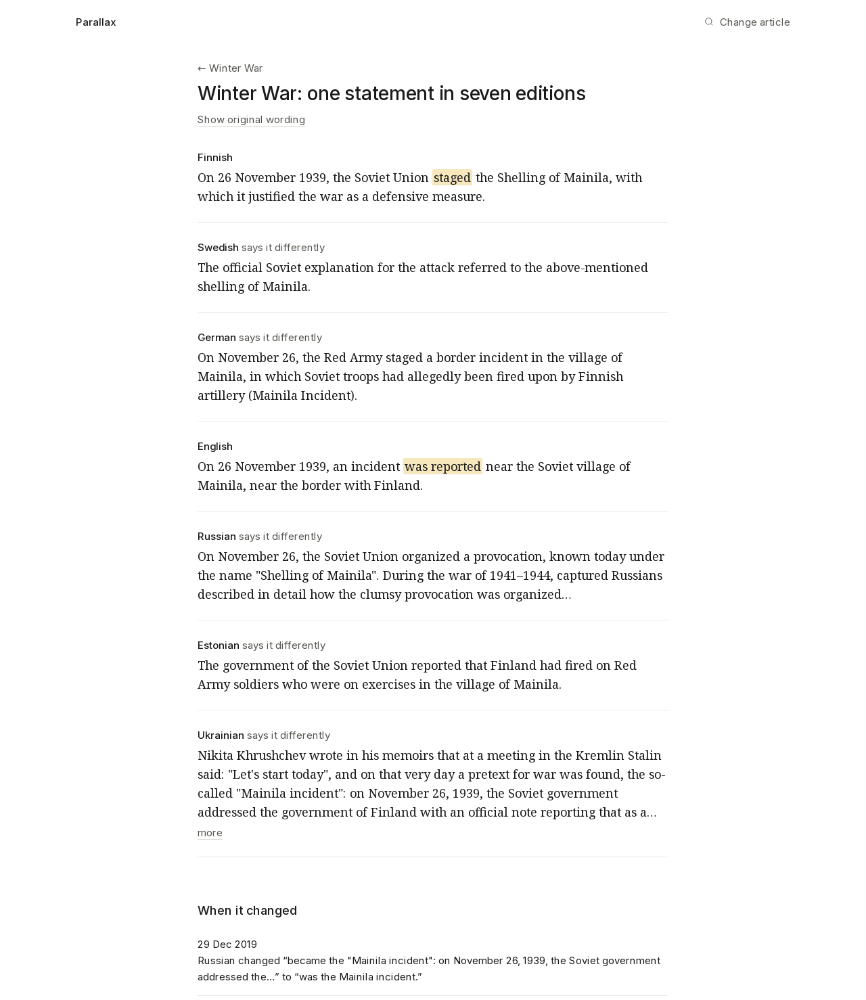
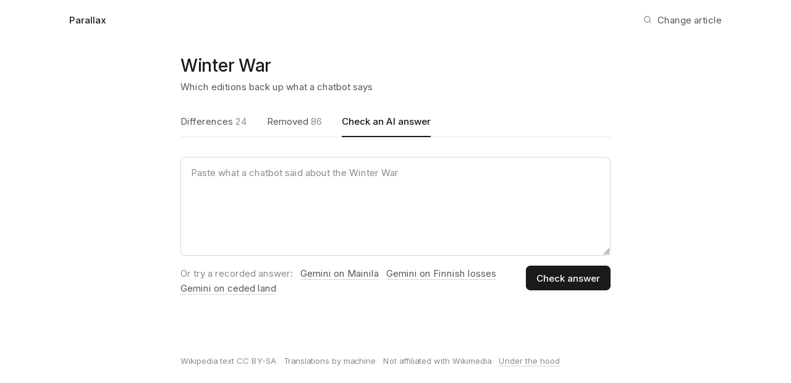

# Parallax

Parallax shows where seven Wikipedia editions (Finnish, Swedish, German, English, Russian, Estonian, Ukrainian) tell the same article differently, statement by statement.
It also lists statements one edition removed while others still have them and it checks a chatbot answer against the editions.
Every version is kept in MariaDB 12.3 system-versioned tables, so any past day can be read back. Vector search matches statements across languages in the same query (`FOR SYSTEM_TIME AS OF` together with `VEC_DISTANCE_COSINE`).

Live: https://135.181.63.238.sslip.io, with the Winter War preloaded. Good places to start:

- https://135.181.63.238.sslip.io/t/Q134949 lists the statements the editions tell differently.
- https://135.181.63.238.sslip.io/t/Q134949?date=2008-06-01 shows the same list as of 1 June 2008.
- https://135.181.63.238.sslip.io/t/Q134949/check checks a chatbot answer. Paste one or pick a recorded Gemini answer below the text box.

Demo video: https://youtu.be/eeRs_a-xHF0

The live server runs on a Verda instance with Docker Compose (see [deploy/README.md](deploy/README.md)) without a language model (`ENGINE=fake`) and with bge-m3 embeddings through Ollama (`EMBED_BACKEND=ollama`).


It only shows evidence and never edits Wikipedia. Background: [docs/PRODUCT.md](docs/PRODUCT.md), [docs/RESEARCH.md](docs/RESEARCH.md), [PLAN.md](PLAN.md).

## Run it locally

Needs Docker, uv, Node 20 and Ollama with `bge-m3` (embeddings).

```sh
cp .env.example .env          # DB_PORT, ENGINE=fake, SEED=v4
make db-up                    # MariaDB in Docker
make seed                     # restores seed v4 (downloads data/seed-v4.sql.gz from the release)
make app-stats                # writes the stat keys the app reads: python -m pipeline.seed_stats --app-keys
make demo                     # builds web/dist and serves app and API on API_PORT (default 8000)
```

Run `make app-stats` again after restoring any seed. `make deploy` runs it on the server too.

For development: `make api` (API only) and `make web` (Vite dev server; `?mock=1` serves the fixture).

## Load any article

Any article that has a Finnish version can be loaded. In the app, type its name on the start page and pick it. A progress page shows each edition and the comparison opens once the Finnish page and a first edition are done (usually 1 to 2 minutes). The rest loads in the background.

From the command line:

```sh
make ingest QID=Q1292442              # one article; SINCE=2021-01-01 loads only recent history
make prepare QIDS="Q1292442 Q155093"  # several
```

## Pages

| Route | Page |
|---|---|
| `/` | Start: search an article, prepared articles, one example |
| `/t/:qid/loading` | Loading progress per edition |
| `/t/:qid` | Differences (`?date=YYYY-MM-DD` for a past day) |
| `/t/:qid/s/:lang/:pageId/:h` | One statement in every edition and when it changed |
| `/t/:qid/removed` | Statements one edition removed while others still have them |
| `/t/:qid/check`, `/t/:qid/check/:runId` | Check a chatbot answer and a checked answer |
| `/hood` | Under the hood: the query, numbers and limits |






## API

The full contract is in [contract/openapi.yaml](contract/openapi.yaml). New with this UI:

- `GET /api/search?q=` finds Wikipedia articles and says whether each is loaded, loading or new.
- `POST /api/ingest {"qid": "Q…"}` starts loading an article. It answers 429 with a retry time when Wikipedia asks us to slow down.
- `GET /api/ingest/:id` returns the job state (`queued`, `running`, `usable`, `done`, `failed`) and progress per edition.

Existing endpoints include `/api/compare`, `/api/timeline`, `/api/dropped`, `/api/check` and `/api/check/recorded`.

`POST /api/check` takes an optional `topic` (topic_id) so the evidence comes from that article only, checks at most 20 statements of an answer and answers 422 `bad_lang` for an edition it does not cover. Checks, new ingests, searches and questions are limited per visitor (429 `too_many`, see `api/ratelimit.py` and `.env.example`); `rate_limited` stays the code for "Wikipedia asked us to slow down". At most `INGEST_MAX_ACTIVE` (3) articles load at once. What a visitor types (an answer, a question, a search) is never kept for `GET /api/sql/{panel}`.

## Seed

Seed v4 holds the Winter War in all seven editions with their full edit history, embeddings, model verdicts and English glosses. [contract/SEED.md](contract/SEED.md) describes the seeds. `make seed-mini` loads a small seed for tests. English glosses made later can be carried to another server with `make gloss-dump` and `make gloss-load FILE=…`.

## Tests

```sh
make test                     # contract, pipeline and API tests
make test-web                 # web unit tests
make e2e                      # browser tests on seed-mini (port 8057)
make demo-check               # walks the demo on the running `make demo` (API_PORT) or BASE_URL=https://… for a deployed one
```

## What is real and what is recorded

- Differences, Removed, past days, statements and their history are computed from the stored Wikipedia versions.
- Model calls (statement matching, translations, checking an answer) go through `ENGINE`. With `ENGINE=real` they use Gemini and need `GEMINI_API_KEY`. With `ENGINE=fake` no language model is called and matching and translations come from what the seed already holds. If `EMBED_BACKEND` names a bge-m3 backend (the live server uses `ollama`), a pasted answer and a newly loaded article are matched by vector similarity. Without it a pasted answer gets a fixed example answer.
- The chatbot answers listed under "Check an AI answer" were recorded once with the real engine (`make record-checks`) and each is labelled with the model that gave it. They are checked again against the editions every time they are opened.

## Limits

- English lines are machine translations, so some wording differences come from the translation.
- Only seven editions and only articles that have a Finnish version.
- The matching model misses some matches. Check the source edition before quoting.
- Large articles take longer than 2 minutes to load on a CPU; embedding is the slow step.
- Statements in an article loaded with `ENGINE=fake` stay untranslated.
