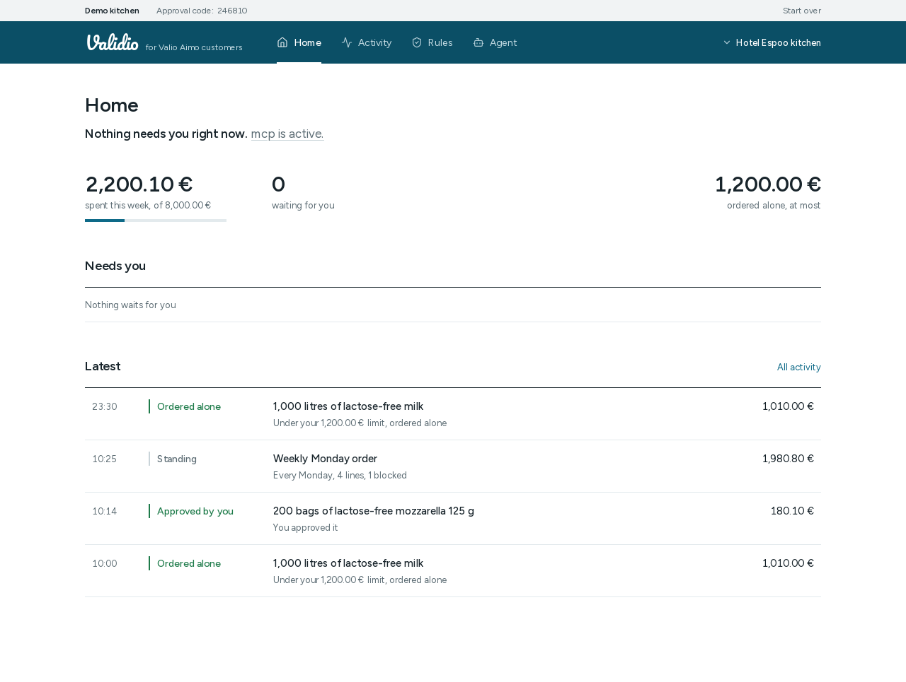
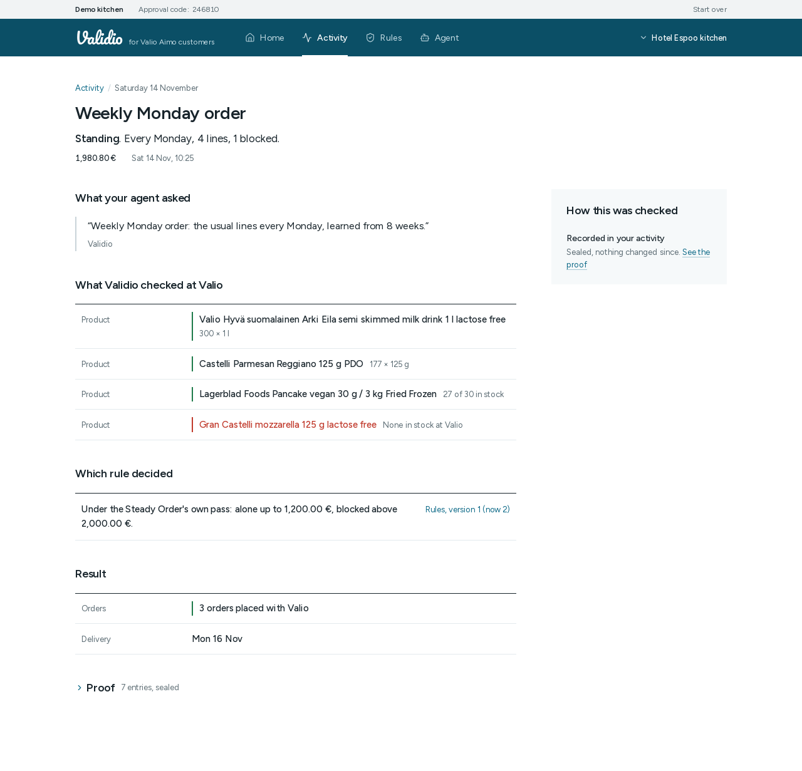
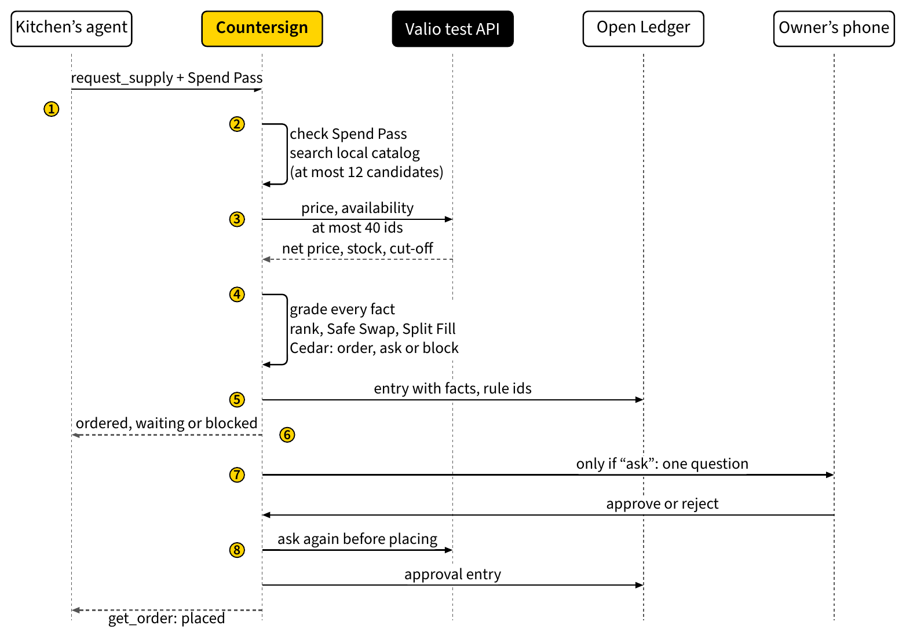

# Validio

A kitchen's purchasing agent orders from Valio Aimo through Validio. Within the Rules the kitchen sets, the agent orders automatically. Above them it needs the owner's approval. Beyond them it is blocked.

Live: https://timkicker--validio.us-east.modal.run. Click **Try the demo kitchen**. Your browser gets its own copy of a filled demo kitchen. The bar on top shows its approval code (246810) and **Start over** in that bar takes the copy back to the start. Nothing you do there reaches Valio or another visitor.



The plan and the reasoning behind each part are in [PROJECT_BLUEPRINT-validio.md](../PROJECT_BLUEPRINT-validio.md). The click path is in [docs/DEMO.md](docs/DEMO.md).

## Quick start with any MCP client

1. Open the demo kitchen, go to **Agent** and click **Connect agent**. The page shows an MCP address of the form `https://…/mcp/c/<token>/`. Keep the slash at the end.
2. Add that address to your agent as a remote MCP server (streamable HTTP, no OAuth). With the Claude Code CLI:

   ```sh
   claude mcp add --transport http validio <URL>
   ```

   A chat app's custom connector works the same way.
3. Ask the agent to order something, for example "1000 litres of lactose-free milk by Monday, budget 1200 euro". Until the kitchen allows it, every tool answers with a verification code like `K7P-3QX`. The read-only tool `connection_status` returns the same code at any time. The Agent page now shows a code as well.
4. If the two codes match, click **Allow**. Validio holds the agent's key and signs every call for it, so the agent never handles a pass, a key or a code.
5. Ask again. The milk is ordered automatically for 1,010.00 € and shows up on **Home** and in **Activity**.

The connector offers seven tools: `search_products`, `request_supply`, `confirm_order`, `get_request`, `get_order`, `renew_steady_order` and `connection_status`. An agent that signs its own Spend Pass pairs with the code under "Agent without MCP" instead. [docs/AGENTS.md](docs/AGENTS.md) covers both ways and OpenAPI.

## The pages

- **Home**: a three-step checklist (Rules, connect the agent, first order) until the first order arrives. After that it shows whether the agent is active, this week's spend, what needs you and the latest activity. It refreshes every two seconds.
- **Activity**: everything the agent did, newest first, filtered by All, Ordered, Waiting, Blocked and Standing. One item reads from top to bottom: what the agent asked for, what Validio checked at Valio, the rule that decided and the result. While an item waits, Approve (with the approval code) and Reject sit here. The ledger entries for the item are folded away under **Proof**.
- **Rules**: what the agent may do, in three groups: Money, Diet and allergens, Substitutes. **Edit** saves all of them at once with the approval code. Every save signs a new version of the agent's Spend Pass and writes one ledger entry.
- **Agent**: connect, the verification code, Allow or Deny, then the agent's name and last use, **Pause** and **Disconnect**. A paused agent is refused on every call and the refusal is logged. Disconnect makes the connector address return 404.
- **Settings** (the kitchen's name at the top right): kitchen name and delivery address, login, approval code, theme, log out.



## Rules

- **Per order.** "Auto-order up to" and "Waiting for you up to" apply to each order. Above the second limit an order is blocked, even with approval. In the demo kitchen these are 1,200.00 € and 2,000.00 €.
- **Per week.** An optional cap on everything the Spend Pass has placed this week. An order that would go over it is blocked. Validio checks this limit before it asks Cedar, so it is not one of the Cedar rules. The demo kitchen has 8,000.00 €.
- **Diet and allergens.** "Must be" takes lactose-free, gluten-free and vegan. "Never" takes the 14 EU allergens. A product is blocked when its own Valio data contradicts the diet or when it lists a "never" allergen. It waits for you when the diet cannot be confirmed, when it may contain a "never" allergen or when it has no allergen data. A diet the request itself names ("lactose-free milk") leaves out every product without that claim. The diet in Rules does not: a product Valio's data says nothing about, such as bananas, stays an option and waits for you.
- **Substitutes.** Off: every substitute waits for you. From Valio's list: a substitute on Valio's own substitute list may be ordered automatically. With extra cost: as from Valio's list, plus a line may be split across products that together cost up to the set percentage more. A substitute that is not on Valio's list always waits for you.

A budget written in the request ("budget 1200 euro") counts too: above it, the order waits for you. Before it places any order, Validio asks Valio again. If a price rose by more than 2 % or a line can no longer be delivered, the order is refused. The rules themselves are listed in [docs/RULES.md](docs/RULES.md).

## Proof

Every decision, approval, Rules change, pause and refusal becomes one sentence in the Open Ledger. Each entry carries the SHA-256 hash of the entry before it. The head of the chain (entry count, last hash and time) is stored next to the chain and moves in the same transaction as each new entry. It is signed with the kitchen's key (ES256). Verification therefore catches an entry that was changed, removed from the middle or cut from the end. It also catches a chain that was rewritten in full by anyone without the key. `GET /api/ledger/head` returns the signed head and the public key, so Valio can pin the head and check later that the ledger still ends there or grew from there. Hidden Spend Pass fields such as the approver list never enter the ledger.

## Valio's answers: real, recorded, 16 to 20 Nov 2026

The 17,546 products, with their claims, allergens, substitutes, delivery reliability and carbon values, come from Valio's challenge files. Every price and availability answer is a real answer from Valio's test API (`junction26.valioaimo.fi`, customer `hotel-espoo`). `make record` asked the API once for each delivery day from Monday 16 to Friday 20 November 2026 and stored the answers. The app replays them and does not connect to Valio while it runs, unless the live fallback below is on.

- Any other delivery day returns `503 not recorded` and the error names the recorded days. The `request_supply` tool's description lists them too, so an agent can choose one. "Monday" means 16 Nov. With no day given, the order is due on 16 Nov.
- Answers were recorded for the products the demo scenes need and for a list of common kitchen requests (milk, cream, cheeses, butter, eggs and others), each with Valio's listed substitutes. Any other product returns "aren't recorded for this demo" and nothing is ordered.
- With `VALIO_LIVE_FALLBACK=1` and `VALIO_API_KEY` in `.env`, replay asks Valio's test API for the products or the delivery day it has no recording for, only those ids, at most 40 per request and never another host. The answer is stored with the recordings, so the next request replays it. Without a key, or when the test API does not answer, it stays "not recorded" or "Valio didn't answer" and nothing is ordered. `make demo` turns the switch on. Tests and `make demo-check` leave it off and never connect.
- Decisions run on a fixed demo clock, Saturday 14 November 2026 10:00 Helsinki time, because Valio's cut-offs and delivery dates in the recordings fit that time. On the live site, what people do is stamped with the real time.

Three things are simulated: the stock-out of mozzarella 466375 (Valio really has it in stock), the 8 weeks of order history behind the weekly Steady Order and the line in product 463047's description that talks to AI agents. We planted that line ourselves and keep it in its own table, apart from Valio's text. The API answers flag the stock-out and the history as simulated and the stock-out has its own ledger entry.

## Architecture



- **FastAPI** (`src/backend/validio/api/`): one Python service for the web app's API under `/api`, the agent API under `/agent/v1` (OpenAPI 3.1) and MCP under `/mcp`. All three call the same functions.
- **Spend Pass** (`policy/mandate.py`): the kitchen's signed permission, an SD-JWT bound to the agent's P-256 key and checked with a single-use nonce. The Rules are claims inside it, so every Rules change signs a new version.
- **Cedar** (`policy/policies.cedar`): four rules decide whether to order automatically, ask a person or block. The rules read only numbers and yes/no values that Validio fills from Valio's data and the pass. Model output and supplier text never reach a decision.
- **Matching and Fact Grades** (`matching/`, `trust/`): the request turns into a typed need, the local catalog narrows it down and at most 40 ids per call go to Valio. Every fact is graded and a missing value never counts as a yes.
- **Semantic search** (`matching/semantic.py`, optional): a small embedding model (BAAI/bge-small-en-v1.5, about 67 MB, CPU) runs on the same machine and proposes more candidates by meaning. No product data or request text leaves the machine. It never decides: what it finds goes through the same checks and Cedar, and a product found only by meaning always waits for a person.
- **MCP** (`api/mcp_server.py`): the connector server at `/mcp/c/<token>/` for any client and `/mcp/k/<account>/` for agents that sign.
- **SvelteKit** (`src/frontend/`): the web app, built to static files and served by the same FastAPI process.
- **Modal** (`src/cloud/app_validio.py`): one container that scales to zero, with SQLite, the catalog index and the recorded answers on the Modal volume `validio-data`. Nothing from Valio is in the image or in git.

More detail is in [docs/ARCHITECTURE.md](docs/ARCHITECTURE.md), [docs/SECURITY.md](docs/SECURITY.md) and [docs/PRODUCTION.md](docs/PRODUCTION.md).

## Run it locally

You need Python 3.12 with uv, Node 20 or newer, the Valio API key and the three challenge files (`valio_aimo_junction26_product_data.json`, `valio_aimo_junction26_delivery_reliability.csv`, `valio_aimo_junction26_carbon_footprint.csv`) in one folder. Every command runs from `validio/`.

```sh
make setup RAW=/path/to/folder   # .env from .env.example, uv sync, web app packages, checks the files' sha256, builds data/catalog.db
# put the key after VALIO_API_KEY= in .env
make record                      # the only network step: Valio's test API, Mon 16 to Fri 20 Nov, into data/cache/valio/
make template                    # optional: plays the five demo scenes into data/template/, the filled demo kitchen
make embed                       # optional: the local semantic search's model and product vectors, about 3 minutes
make demo                        # builds the web app, seeds and serves everything on http://127.0.0.1:8410
```

Open http://127.0.0.1:8410 and click **Try the demo kitchen**. Without `make template`, a demo copy starts from the plain seed. Without `make record`, every request returns "not recorded", unless `VALIO_API_KEY` is set: then `make demo` asks the test API for what is missing and records it.

To look at the web app alone, without a key or data: `cd src/frontend && npm ci && npm run kit`, then `make demo-mock` from `validio/`. The app then runs on a fixture on http://127.0.0.1:8411 and no agent can talk to it.

Other targets:

```sh
make dev                         # only the API on :8410, reloading on changes
make agent SCENE=2               # our own agent runs scene 1, 2 or 3 and prints every tool call
```

## Tests

```sh
make test                        # guard checks, ruff, pytest, svelte-check and the Playwright specs (no network)
make demo-check                  # the five demo scenes end to end on their own server (port 8418), ends with ALL SCENES OK
make e2e-live                    # the web app against the real backend, with a real MCP client connected on the Agent page
make a11y                        # axe-core WCAG 2.2 AA on every page at 1280 and 390 px, light and dark
make test-live                   # the tests that need the network
make mutate                      # mutation testing on the deciding modules (slow)
```

`make guards` (part of `make test`) fails on a committed key or `.env` and on any address of Valio's production systems outside `docs/`. Details are in [docs/TESTING.md](docs/TESTING.md).

## Deploy

```sh
make modal-data                  # upload data/catalog.db, data/cache/valio and, after make embed, the model and vectors
make modal-secret                # the secret validio-web from a gitignored env file
make modal-deploy                # build the web app, deploy, then fill the demo kitchen template in the volume
```

The image installs the semantic extra and sets `VALIDIO_SEMANTIC=1`. The model and the vectors are read from the volume (`data/models`, `data/embeddings.npz`). Without them the app matches by keyword only. With `VALIDIO_PUBLIC=1` the app refuses to start without its approval code and kitchen token. Stop it with `modal app stop validio-web`.

## Folders

| Path | What is in it |
|:---|:---|
| `src/backend/validio/api/` | FastAPI app, MCP servers, accounts, agent connect, Rules and Settings, Home and Activity |
| `src/backend/validio/policy/` | Spend Pass (SD-JWT) and the Cedar rules |
| `src/backend/validio/orders/` | requests and their decisions, plus orders that ask Valio again before placing |
| `src/backend/validio/matching/`, `trust/` | need parsing, ranking, Safe Swap, Split Fill, Fact Grades and the claim check |
| `src/backend/validio/catalog/`, `valio/` | the SQLite index over Valio's product file and the test API client with record and replay |
| `src/backend/validio/audit/` | the Open Ledger |
| `src/backend/validio/standing/` | Steady Orders and Drift Watch |
| `src/backend/validio/reader/` | a reader that flags supplier text aimed at agents; it is only shown and never decides |
| `src/backend/validio/agent/` | our own purchasing agent for the demo scenes, run by `make agent` |
| `src/backend/validio/demo/` | the seed, the simulated history and the planted line |
| `src/frontend/` | the SvelteKit web app |
| `src/cloud/` | the Modal app |
| `scripts/` | import, indexing, recording, seeding, demo checks and guard checks |
| `data/` | Valio's files, the catalog index, recorded answers and local stores (gitignored) |

## Limits

- Valio's test API has no order endpoint, so "placed" means placed in Validio.
- Only 16 to 20 Nov 2026 and the recorded products can be ordered. The decision clock stands still at 14 Nov 10:00.
- Each kitchen has one shared 6-digit approval code. There are no named approvers, passkeys or two-factor login.
- The weekly limit is checked in Python, not in Cedar.
- Steady Orders renew only through the agent's `renew_steady_order`. The web app has no button for it. Split Fill only runs during a renewal.
- SQLite on one Modal container. Production needs Postgres and a shared nonce store ([docs/PRODUCTION.md](docs/PRODUCTION.md)).
- The supplier text reader is a pattern matcher without a model. The model-based reader is not deployed.
- The semantic search model is small and does not reason. A vague request such as "something to make risotto creamy" gets loose matches, and they wait for a person.
- Valio's data and the recordings never go into git, because Valio allows their use for this challenge only.
