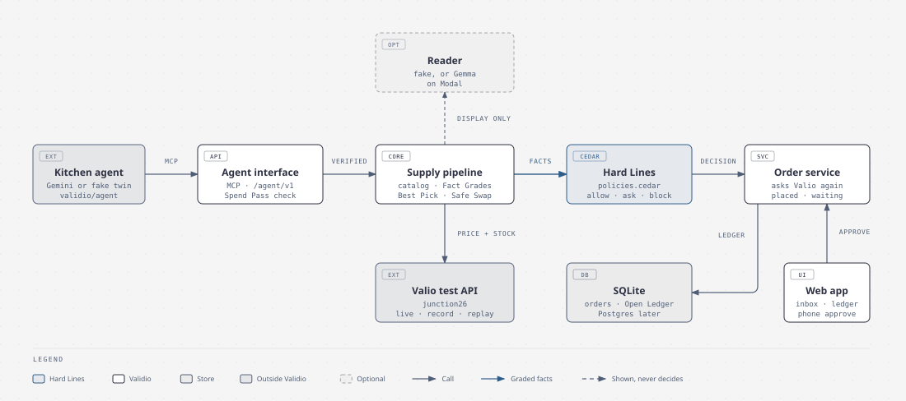
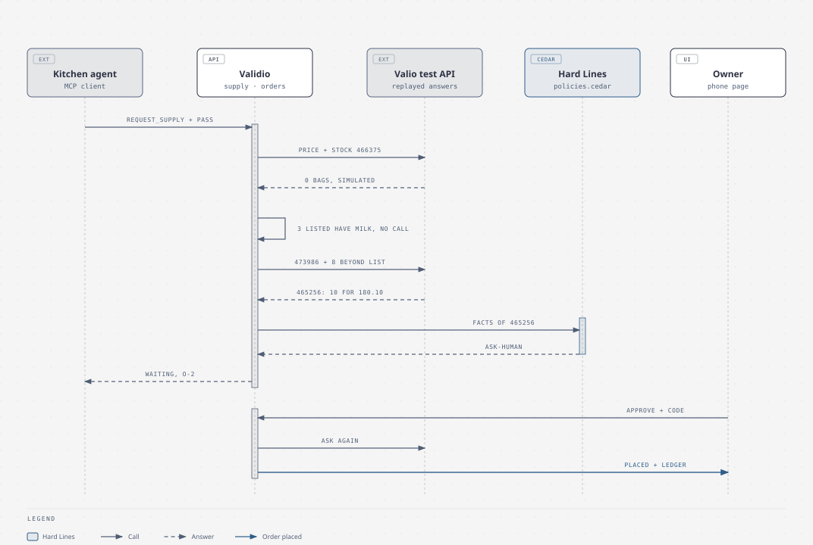

# Architecture

Validio is one Python service between a kitchen's purchasing agent and Valio. The agent asks for supply. Validio checks the agent's permission, grades every fact Valio gives, ranks the options and lets Cedar decide. Then it orders automatically, asks a person or blocks. Each step leaves one sentence in a chained ledger. The AI model can ask and explain, but no decision runs through it.

File paths are relative to `src/backend/validio/` unless they start with `scripts/` or `src/`.

## Components

| Component | Code | What it does |
|:---|:---|:---|
| Kitchen agent | `agent/buyer.py`, `agent/llm.py`, `agent/port.py`, `agent/holder.py` | A loop of model step and tool call. The port adds the Spend Pass and the idempotency key to every write. `scripts/agent.py` runs it for the demo |
| Agent interface | `api/mcp_server.py`, `api/agent_v1.py`, `api/tools.py` | The same six tools over MCP at `/mcp` and over HTTP with OpenAPI 3.1 under `/agent/v1`. Both call the functions in `api/tools.py`. The connector server at `/mcp/c/<token>/` adds `connection_status` and signs for any MCP client (`api/connect.py`) |
| Spend Pass | `policy/mandate.py` | The kitchen's signed permission as an SD-JWT, bound to the agent's key, with single-use nonces |
| Catalog | `catalog/store.py`, `scripts/index_catalog.py` | Valio's product data, read only, indexed once into a SQLite file |
| Valio client | `valio/client.py`, `valio/budget.py` | Price and availability from Valio's test API, live, recorded or replayed, at most 40 ids per request |
| Fact Grades | `trust/levels.py`, `trust/claims.py` | How far each fact can be trusted. A diet claim is checked against the product's other fields |
| Matching | `matching/need.py`, `matching/rank.py`, `matching/substitute.py`, `matching/split.py` | The typed need, Best Pick, Safe Swap and Split Fill |
| Semantic search | `matching/semantic.py`, `scripts/embed_catalog.py` | Optional. A small local model proposes more candidates by meaning. It never decides |
| Hard Lines | `policy/decide.py`, `policy/policies.cedar` | Cedar decides: order automatically, ask a person or block |
| Order service | `orders/supply.py`, `orders/service.py`, `orders/store.py` | One request from text to decision, then orders that ask Valio again at every step |
| Open Ledger | `audit/log.py`, `audit/sentences.py` | One sentence per decision, chained by SHA-256 |
| Steady Orders | `standing/learn.py`, `standing/drift.py`, `standing/renew.py`, `api/steady.py` | The usual weekly order, Drift Watch and renewal |
| Reader | `reader/service.py`, `reader/fake.py`, `reader/remote.py` | A note next to supplier text for the person on screen. It never decides |
| Web app | `api/activity.py`, `api/settings.py`, `api/accounts.py`, `api/ui.py`, `api/app.py`, `src/frontend` | The web app's API under `/api` and the SvelteKit app: Home, Activity, Rules, Agent and Settings, one account per kitchen |

`docs/RULES.md` lists the four Cedar rules and the context fields they read. The Rules' optional per week limit is checked before Cedar, in `_judge` in `orders/service.py`, because it is the only limit that counts orders already placed. `test_rules_doc.py::test_every_rule_documented_with_its_inputs` keeps that page in line with the policy file.

## One request end to end

Scene 2 of the demo: "1000 litres of lactose-free milk by Monday, budget 1200 euro".

1. **Agent.** The model picks `request_supply`. `agent/holder.py` fetches a fresh nonce from `GET /agent/v1/nonce` and presents the Spend Pass with it. `agent/port.py` adds that presentation to the call. Only budget, hard cap and diet are shown. Whatever Validio answers goes back to the model through `redact` in `agent/tools.py`, so supplier text never reaches it.
2. **MCP or OpenAPI.** The call arrives at `/mcp` or at `POST /agent/v1/requests`. Both land in `request_supply` in `api/tools.py`. `test_mcp.py::test_mcp_and_http_give_the_same_result` holds them equal.
3. **Spend Pass check.** `verify_presentation` in `policy/mandate.py` checks signature, ES256, issuer, key binding, audience, the single-use nonce and the validity window. A failure is HTTP 401 and nothing else happens.
4. **Catalog.** `parse_need` in `matching/need.py` turns the text into a typed need: 1000 litres, lactose free, by 16 Nov. `screen` narrows the catalog to at most 12 candidates and writes a reason for every product that drops out. None of this makes a live call. How a product phrase is read is in "Reading the product" below.
5. **Valio.** `valio/client.py` asks Valio's test API for price and availability of those candidates only. `valio/budget.py` counts the ids. The default mode is replay, which answers from recorded files and opens no connection. With `VALIO_LIVE_FALLBACK=1` and a key, replay asks the test API for the ids or the day it has no recording for and stores the answer next to the recordings. In scene 2 that is 12 products in 4 calls.
6. **Fact Grades.** `trust/levels.py` grades price, stock, delivery and every diet claim: attested, consistent, unchecked, contradicted, missing or unknown. `trust/claims.py` checks the lactose claim against ingredients and allergens. 463047 is low lactose and fails here. Its planted description is graded untrusted.
7. **Best Pick, Safe Swap, Split Fill.** `best_pick` in `matching/rank.py` sorts on five keys: every hard rule passes, total cost (within 5 % of the cheapest counts as equal), delivery reliability, labels the Spend Pass asks for, carbon. 464306 wins at 1,010.00 €. When the asked product cannot be delivered, `safe_swap` in `matching/substitute.py` takes over (scene 3, below). Split Fill in `matching/split.py` runs today only when a Steady Order renews (`standing/renew.py`), not for a single request.
8. **Hard Lines.** `context_for` in `policy/decide.py` fills Cedar's context with whole numbers and yes/no values only. Cedar answers with a rule id: `auto-order`, `ask-human`, `never-break-diet` or `never-over-hard-cap`. A policy file that fails to parse stops the app at start (`test_policy.py::test_broken_policy_stops_the_app`). For 464306, 1,010.00 € is inside the auto limit of 1,200.00 € and every needed fact is attested, so the outcome is order automatically.
9. **Order service.** The agent calls `confirm_order`. `submit` in `orders/service.py` asks Valio again for every price and amount, asks Cedar again and lands in placed, waiting or blocked. A price the agent sends is never read. The idempotency key turns a retry into the same order. Valio's test API has no order call, so "placed" means placed in Validio.
10. **Ledger.** Every step above writes one sentence with its facts into `audit/log.py`. Each entry carries the SHA-256 of the one before. For scene 2 the order's entry starts with "Ordered 1000 ST of 464306" (`test_orders.py::test_scene2_ledger_sentence`).
11. **Web app approve.** Home and Activity read `/api/home`, `/api/activity` and `/api/activity/{id}`. When Cedar says ask a person, the order waits under Needs you. The owner opens it in Activity, types the approval code, and `POST /api/orders/{id}/approve` asks Valio again. It refuses a price rise of more than 2 % and asks Cedar again, so a person can lift "ask" but never a block.

## Reading the product

A request names its product in a short English noun phrase, and English puts the head noun last. `_product_word` in `matching/need.py` reads the phrase from its last word. "10 kg of yellow onions" is onions and "20 litres of vegetable stock" is stock.

1. **The phrase.** `product_phrase` takes the words after the quantity, up to a day, a budget or a pack size. The head noun ends before "for", "with" or "to", so "onions for the soup" is onions.
2. **Longest first.** Three or two words that end at the head noun are tried first ("whipping cream", "banana puree", "red onion"), then the head noun alone. Each form is tried in Valio's words first, then as written, and singular before plural.
3. **Kitchen words.** `SYNONYMS` is a short list of kitchen words that Valio names another way. Each was checked against the catalog: stock and broth are bouillon or fond, scallion is spring onion, heavy cream is whipping cream, parm is parmesan. `SAME` lists two names for one thing that both occur in Valio's names, such as courgette and zucchini. A kind with two names searches both.
4. **Modifiers.** The other words, such as "yellow", "peeled" or "fresh", never pick the kind. They only order the candidates: products whose names hold them go first. Products with a colour the request did not ask for go after the plain ones, so "onions" checks the plain onions before the red ones.

The fixed kinds milk, mozzarella and oat drink keep their own screening, and the semantic search below leaves them alone. Fresh produce still wins for a plain fruit or vegetable word, so "bananas" stays the fresh 4.5 kg pack and "banana puree" stays the purées.

## Semantic search, local and optional

With `VALIDIO_SEMANTIC=1`, a small embedding model adds candidates by meaning. `make demo` and `make demo-web` turn it on. Tests and `make demo-check` run without it unless it is set.

- **What runs where.** The model is BAAI/bge-small-en-v1.5, quantised to ONNX, about 67 MB, run on the CPU by fastembed. `make embed` (`scripts/embed_catalog.py`) fetches it once from Hugging Face into `data/models`. Then it embeds every product's English name with its group name, such as "knorr vegetable bouillon 5kg/333l (in sauces, dressings and stock)". This takes about 3 minutes and writes `data/embeddings.npz` (14 MB, gitignored). At request time the product phrase is embedded on the same machine in a few milliseconds and compared with every product by cosine. No product data and no request text leave the machine.
- **What it may do.** It only proposes. In `screen`, a keyword candidate that also scores near the best is checked live first when the cap of 12 cuts. Products found only by meaning are added when the keyword path finds fewer than 2 candidates, or when its best is far below the best match. Every one of them goes through the same screening as a keyword candidate: the request's diet, the kitchen's diet, look-alikes, pack size, Valio's price and stock and Cedar. One that fails is not shown at all, because the request never named it. The thresholds sit in `matching/semantic.py`.
- **It never orders alone.** A product found only by meaning goes to Cedar as a substitute outside Valio's list, so `auto-order` cannot match and the order waits for a person. Its sentence says "Found by meaning, not by its name" (`test_semantic.py::test_a_candidate_by_meaning_waits_for_a_person_where_the_same_by_name_orders`).
- **Product search.** `search_products` uses the same rules through `search_catalog` in `matching/need.py`. Kitchen words work without the model too, so "vegetable stock" finds the vegetable bouillons.
- **When it is missing.** Without fastembed, the model or the embeddings file, Validio logs one line and matches by keyword only. Install the extra with `uv sync --extra semantic`; `make embed` does it for you.
- **Limits.** The model is small. It finds "beef mince" products that the keyword path misses and puts the bouillon cubes first for "stock cubes". It does not reason: "something to make risotto creamy" finds cream and starch products, not parmesan or butter. The agent should ask for the product itself.

## Scene 3 in sequence

The template build (`scripts/demo_check.py`, no HTTP route) first switches on the simulated stock-out of 466375 in the store. Then the agent asks for 200 bags. Valio's answer shows 0 bags. `safe_swap` walks Valio's own substitute list first, in Valio's order. Three of the four list milk and have no lactose-free claim. That needs no live call, because the diet check uses catalog data only. 473986 is lactose free, but Valio gives no delivery date for it. So Safe Swap searches the catalog with at most 8 more ids and finds 465256, 10 × 2.5 kg for 180.10 €. A substitute outside Valio's list always goes to a person, so Cedar answers `ask-human` and the order O-2 waits. The owner approves on the phone, Validio asks Valio again and places the order. Over the whole request 10 products were checked live.

## What can be replaced

**The agent's model.** `make_llm` in `agent/llm.py` picks Gemini when `GEMINI_API_KEY` is set (`GEMINI_MODEL`, default gemini-3.8-flash) and a deterministic twin otherwise. Both make the same tool calls (`test_agent.py::test_gemini_buyer_scene2_three_runs_same_order`). Any MCP client works, because Validio never trusts what the model says. Swapping the model changes how a request is worded, not what gets ordered.

**The reader.** The fake reader in `reader/fake.py` is the default. With `READER_MODE=modal`, `reader/remote.py` calls Gemma 4 26B served by vLLM on Modal (`src/cloud/gemma_app.py`). It is not deployed tonight, because Modal's GPUs need a payment method on the workspace. Any reader that answers the fixed shape in `reader/schema.py` fits. A reader that fails falls back to the fake one with a note in the ledger. No deciding module imports the reader (`test_reader.py::test_deciding_code_never_imports_reader`).

**The semantic model.** `FastEmbedder` in `matching/semantic.py` is the only class that knows fastembed. Any model that turns a phrase into a normalised vector fits, as long as `make embed` uses the same one. The file records the model's name, and a file from another model is ignored.

**Storage.** Everything lives in two SQLite files under the ignored data folder. The catalog file is read only. The second file holds requests, orders and idempotency keys (`orders/store.py`), the Open Ledger (`audit/log.py`) and the demo seed (`demo/seed.py`). Postgres is the plan for later. The change sits in `orders/store.py` and `audit/log.py`, plus a shared nonce store in place of the one in memory in `policy/mandate.py`.

**Valio.** `VALIO_MODE` switches between live, record and replay in `valio/client.py`. `VALIO_LIVE_FALLBACK=1` lets replay ask the test API for what has no recording, off by default. Only Valio's test API host is accepted. [SECURITY.md](SECURITY.md) explains why and which tests hold it.

**The rules.** The Hard Lines live in one Cedar file, `policy/policies.cedar`. It can change without touching Python, as long as the context fields stay the same. `adversarial/test_policy_props.py::test_deny_wins_whatever_else_is_true` and the other property tests check every change.
